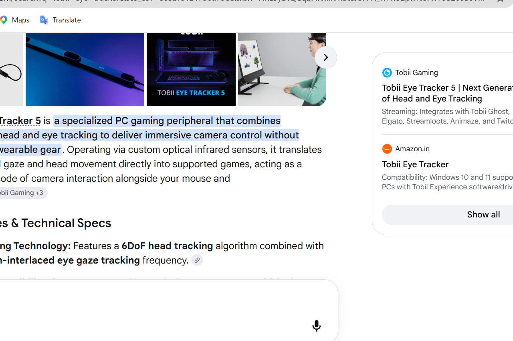
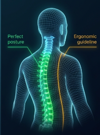

# Vision360

Hands-free accessibility and digital wellness for your desktop. Control the mouse with head movement, dwell-click, scroll by tilting, type with an on-screen keyboard, and protect your eyes and posture with blink tracking, a 20-20-20 break timer, a posture guardian and Eye Gym exercises. Everything runs locally — your camera feed never leaves your computer.

## Screenshots




## Download (Windows 10/11)

1. Go to the [Releases page](../../releases/latest) and download `Vision360-windows.zip`.
2. Unzip it and open `Vision360\Vision360.exe`.
3. Allow camera access when asked.

> Windows may show "Windows protected your PC" because the app isn't code-signed. Click **More info → Run anyway**.

**Requirements:** Windows, a webcam, good front lighting. Place the camera at eye level, about 50–65 cm away.

## Run from source

```
pip install -r requirements.txt
python vision360_ui.py
```

Python 3.10–3.12 recommended.

## Build the .exe yourself

```
build_windows.bat
```

Output: `dist\Vision360\Vision360.exe`.

## Privacy

Profiles and stats are stored only on your computer in `%APPDATA%\Vision360`. No data is uploaded.
